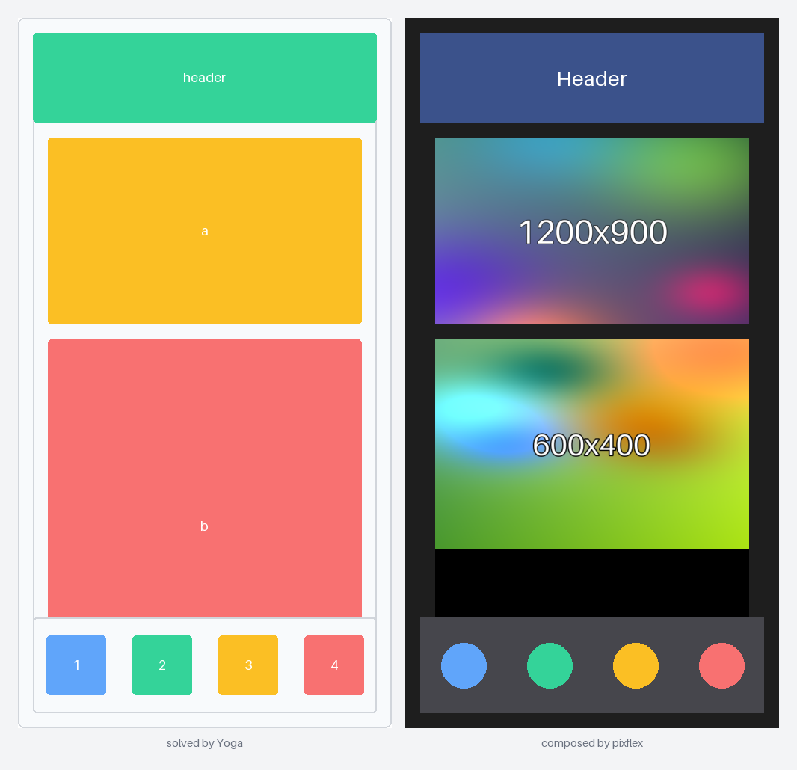
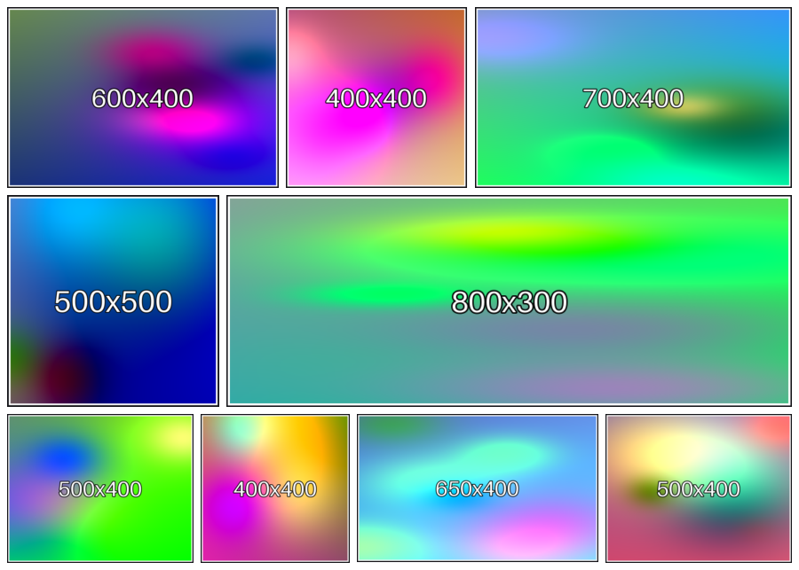
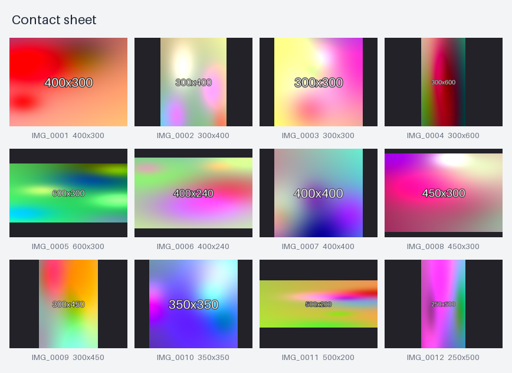
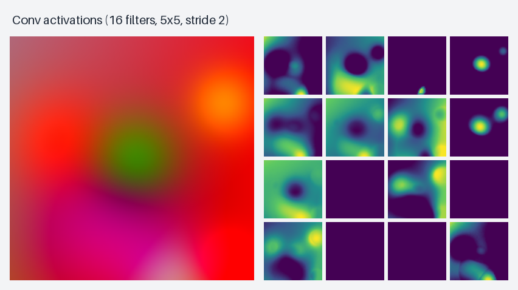

# pixflex

Lay out images the way you lay out a web page. Describe the arrangement as a flexbox tree,
let [Yoga](https://www.yogalayout.dev/) work out every rectangle in whole pixels, then place
numpy / torch / any [array-API](https://data-apis.org/array-api/) arrays into it — with as few
copies as possible and no manual index shifting.

```python
import numpy as np
from pixflex import Column, Row, Slot

with Column(width=1280, height=720, background=(16, 16, 20)) as root:
    title = Slot(height=80)
    with Row(flex=1, gap=8):
        video = Slot(flex=3, fit="contain", background=(0, 0, 0))
        plot = Slot(flex=1, fit="exact")
    footer = Slot(height=40)

plan = root.solve()  # no arrays involved
plan[plot].hw  # (600, 318): render your plot at exactly this size
img = plan.compose({title: t, video: frame, plot: p, footer: f})  # one allocation
```

## Gallery

Every image here was produced by pixflex itself (Yoga solves the layout, arrays are composed
into one buffer). [**See the full gallery with code →**](docs/GALLERY.md)

<table>
<tr>
<td><a href="docs/GALLERY.md#the-yogalayoutdev-homepage-layout"></a></td>
<td><a href="docs/GALLERY.md#justified-rows-flickr-style"></a></td>
</tr>
<tr>
<td><a href="docs/GALLERY.md#contact-sheet-with-captions"></a></td>
<td><a href="docs/GALLERY.md#torch-feature-maps"></a></td>
</tr>
</table>

Also: photo collage, before/after, one layout at three widths, and recreations of the Yoga docs'
`justify-content`, `align-items`, `flex-direction`, `flex-wrap`, `gap`, `position: absolute`
and sizing playgrounds.

## Concepts

- **Declare** with `Column`/`Row`/`Box` (containers, usable as `with` blocks or with
  `children=[...]`) and `Slot` (leaves). Style keywords are CSS-like and come from
  [`yogalayout`](../yogalayout): `flex=1`, `gap=8`, `padding=(10, 20)`, `margin_inline=10`,
  `position="absolute"`, `"50%"`, ...
- **Solve**: `plan = root.solve()` gives absolute integer `Rect(y, x, h, w)`s, no arrays touched.
- **Place**: `plan.compose({...})`, or keep a reusable `Canvas` (below).
- **Fit** per slot or per write, following CSS `object-fit`: `contain` (default), `cover`
  (crops first, so only kept pixels are resized), `fill`, `none`, `scale-down`, `exact` (raises
  `ShapeMismatch` instead of resizing). `align` follows `object-position`
  (`"top left"`, or an `(x, y)` fraction pair).
- **Writes never change the layout and never leave their slot's rectangle.**
- **Stacking follows tree order** (CSS painter's algorithm): later nodes draw on top of earlier
  ones, whatever order you write content in. A slot absolutely positioned over another (a logo
  over a video) is redrawn automatically, clipped to the overlap, whenever the slot below is
  rewritten. (Pixels of overlaying slots are kept for this; mutate your array in place and the
  next redraw shows the new data.)

## Addressing slots

Plans and canvases are indexed by **any hashable**. Recommended, in order:

1. **Handles** — the `Slot`/`Box` objects themselves (identity-hashed), bundled in a
   `NamedTuple` if you build the layout in a function. Static checkers can follow them.
2. **Enum members** (or tuples, ints...) via `Slot(key=Panel.VIDEO)`; with
   `root.solve(key_type=Panel)` pyright rejects `cv["video"]` and typos.
3. **Strings** for scripts and config-driven layouts. Unknown keys raise `KeyError` with a
   "did you mean" hint; duplicates raise `DuplicateKeyError` at `solve()`.

`cv.untyped` / `plan.untyped` give a `Hashable`-keyed view when key types are mixed.

## Reusing a canvas (video, dashboards)

```python
cv = plan.canvas(like=header_img, static={title: header_img, footer: footer_img})
for frame in frames:
    cv[video] = frame  # only the video slot's rectangle is rewritten
    writer.write_frame(cv.array)  # live buffer, zero copy
keep.append(cv.snapshot())  # explicit copy when you need to keep a frame
```

- Constant slots are drawn once. When a `contain`/`none` placement changes size, only the
  stale padding strips are cleared.
- `cv.clear(k)`, `cv.update({a: x, b: y})`, `cv.sub(box)` (a view-backed canvas with box-relative
  rects), `cv.view(k)` (no-copy view), `cv.to_numpy()` (the one device→host copy).
- `cv.ring(n)` cycles `n` pre-drawn buffers for async consumers (encoder threads).
- Leading axes: `plan.canvas(like, axes="THWC")` broadcasts static parts over time and writes a
  whole clip with one batched resize. Axes may use `H W C T N` in any order (`"CHW"`, `"HW"`...).

## Mismatched data

| Mismatch | Behaviour |
|---|---|
| Size ≠ slot | slot's `fit` applies; `exact` raises `ShapeMismatch` |
| 1 channel into C | broadcasts; missing channel axis is added |
| RGBA into RGB | raises unless `alpha="drop"` or `"over"` |
| dtype | cast only if lossless (`can_cast`); else `DTypeMismatch`; `convert=fn` overrides |
| device / array library | raises (`to_device=True` allows a transfer) |

## Backends and resizing

Allocation and writes go through `array-api-compat`, so numpy and torch work today (both are
tested). Resizers are chosen lazily: torch → `F.interpolate(antialias=True)`; numpy → OpenCV, else
Pillow (uint8 / float32), else SciPy. Install one (`pip install pixflex[resize]`) or plug in
your own with `pixflex.register_resizer("numpy", fn)`. **Not yet supported:** immutable arrays
(JAX) and cupy are untested.

## Development

```
uv venv && uv sync          # yogalayout is taken from ../yogalayout (see pyproject)
.venv/bin/python -m pytest
python examples/video_overlay.py    # writes out/video_overlay.mp4
```

MIT licensed.
